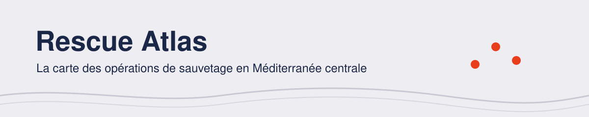

<picture>
  <source media="(prefers-color-scheme: dark)" srcset=".github/assets/banniere-sombre.svg">
  
</picture>

  
  
  

SOS MEDITERRANEE recherche et secourt les personnes en détresse en Méditerranée centrale. Avec
les bénévoles de [Data for Good](https://dataforgood.fr/), on fait vivre la
[carte publique de ses opérations](https://map.sosmediterranee.org/) : pour la transparence, le
plaidoyer et la collecte de fonds.

> [!NOTE]
> **Le projet démarre.** Ce dépôt contient un projet Django et une app Vue tout juste créés, avec
> un modèle vide. Chaque pièce arrive par une issue. Les décisions prises jusqu'ici sont dans
> [docs/decisions.md](docs/decisions.md).

## Contribuer

1. Présente-toi sur le canal du projet, sur le Mattermost de Data for Good.
2. Lis [CONTRIBUTING.md](CONTRIBUTING.md) : le chemin d'une issue jusqu'au merge.
3. Installe le projet avec [TECHNICAL.md](TECHNICAL.md).
4. Prends une issue `good first issue`, puis suis la [progression](docs/progression.md).

Tu ne codes pas ? Tester la carte, relire un texte ou proposer une idée sur le canal, ça compte
aussi.

## Licence

[MIT](LICENSE). Ce n'est pas le site officiel de SOS MEDITERRANEE.
