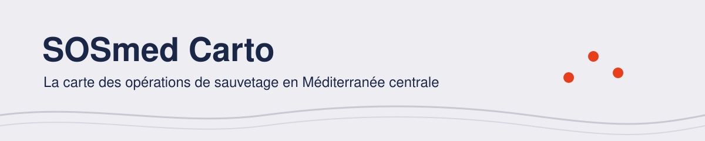
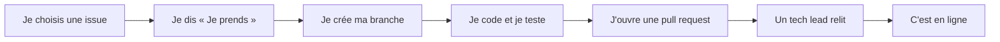

<picture>
  <source media="(prefers-color-scheme: dark)" srcset=".github/assets/banniere-sombre.svg">
  
</picture>

  
  
  
  

  <a href="https://map.sosmediterranee.org/">La carte actuelle</a> ·
  <a href="docs/guides/README.md">Le guide des bénévoles</a> ·
  <a href="https://dataforgood.fr/">Data for Good</a>

SOS MEDITERRANEE recherche et secourt les personnes en détresse en Méditerranée centrale. Avec
les bénévoles de [Data for Good](https://dataforgood.fr/), on refait la carte publique de ses
opérations, pour trois usages : **la transparence**, **le plaidoyer** (journalistes, chercheurs,
étudiants) et **la collecte de fonds**.

Chaque opération affichée a été vérifiée par une personne avant d'être publiée. Ce qui n'est pas
connu reste vide : la carte n'invente jamais un chiffre.

> [!NOTE]
> Socle en construction. La carte actuelle n'est plus mise à jour depuis février 2024.

## Contribuer

> [!TIP]
> Première fois ? Commencez par le [guide des bénévoles](docs/guides/README.md) : cinq minutes
> pour savoir comment l'équipe marche et par où entrer.

| Je veux… | Par où commencer |
|---|---|
| **Coder** (Django, Vue, données) | Une issue [`good first issue`](https://github.com/dataforgoodfr/mediterranean-rescue/issues?q=is%3Aopen+label%3A%22good+first+issue%22), puis [CONTRIBUTING.md](CONTRIBUTING.md) |
| **Aider sans connaître Git** | Corriger un texte directement dans GitHub : ouvrir le fichier, puis le crayon « Modifier » |
| **Aider sans coder** | Tester la carte, relire un texte, proposer une idée : sur le canal du projet du Mattermost de Data for Good |

Installer le projet et le lancer en local : [TECHNICAL.md](TECHNICAL.md).

## Licence

[MIT](LICENSE). Sans lien avec CartONG ; ce n'est pas le site officiel de SOS MEDITERRANEE.
