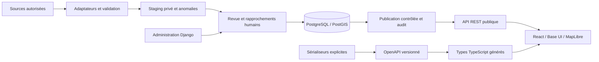

# Mediterranée Rescue : document de départ

**Decision de priorisation du 24 octobre 2026 :** [terminer le chantier en cours sans gel, puis recadrer le prochain backend sur des besoins prouves](EXECUTION-PRIORITIES-2026-10-24.md). Ce document precise l'ordre de travail et ne remplace aucune ADR ni aucune recette du lot en cours.

Version 1, 24 octobre 2026. Responsable du fork : Guillaume Flambard. Statut : projet indépendant en construction, à cadrer avec Data for Good et SOS MEDITERRANEE. Ce document est la référence de lancement ; les contrats détaillés, preuves et tâches exécutables sont liés en fin de document.

## 1. Ce que nous voulons construire

Une plateforme qui permet de comprendre les actions en Méditerranée à partir d’événements documentés : les situer, les filtrer, lire leur contexte et retrouver leurs sources. Chaque nombre et chaque position doivent pouvoir être expliqués. L’objectif est une application durable que des bénévoles peuvent reprendre, faire évoluer et exploiter.

La qualité du projet se mesure autant à la fiabilité de la donnée et à la facilité de mise à jour qu’à la carte. Le premier résultat utile sera un parcours complet : une source autorisée entre dans le système, ses anomalies sont examinées, un événement est publié, le public le consulte et un responsable peut le corriger ou le retirer.

Nous ne fixons pas une date de livraison au nom de l’association. L’annonce évoque un engagement jusqu’en mars : année, disponibilité de la mission et équipe actuelle restent à confirmer. Les décisions ci-dessous engagent notre fork ; elles constituent une proposition pour les partenaires.

## 2. Utilisateurs et parcours à valider

| Public | Besoin proposé | Parcours initial |
| --- | --- | --- |
| Visiteur, journaliste, enseignant | Comprendre une période et citer une source | Filtrer → parcourir carte/liste → ouvrir fiche → suivre provenance |
| Personne chargée de la donnée | Actualiser sans casser l’historique | Importer → lire anomalies → rapprocher identités → préparer brouillons |
| Responsable éditorial | Contrôler ce qui devient public | Vérifier droits et contenu → publier avec motif → retirer/corriger si nécessaire |
| Développeur bénévole | Contribuer avec peu de contexte implicite | Lancer localement → prendre une tâche bornée → vérifier → proposer une PR |

Ces publics et les priorités éditoriales sont des hypothèses à confronter à SOS/DfG, pas les résultats d’entretiens déjà réalisés. La liste accessible reste un parcours complet même si la carte WebGL échoue.

## 3. Existant vérifié et stratégie de reprise

Le dépôt [dataforgoodfr/mediterranean-rescue](https://github.com/dataforgoodfr/mediterranean-rescue) était un squelette Python. Nous avons créé le [fork de travail](https://github.com/guillaume-flambard/mediterranean-rescue), sans repartir d’un dépôt isolé de cet historique. La branche de développement est `feat/platform-foundation` ; `main` conserve la base upstream tant que la contribution n’est pas revue.

L’existant métier principal est la [carte SOS](https://map.sosmediterranee.org/) et son [code CartONG](https://github.com/CartONG/SOSMedDashboard) : Vue/TypeScript/Mapbox, avec lecture de trois onglets Google Sheets. Ce n’est pas un backend Django déjà en service à remplacer. Les contrats et anomalies observées sont décrits dans [l’inventaire](data-catalog.md).

| Source | Contenu observé | Intégration prévue | Point à résoudre |
| --- | --- | --- | --- |
| Data_operations | Sauvetages, transferts, évacuations, effectifs, positions, médias | Snapshot autorisé → adaptation → staging | Identités stables, dates, coordonnées, droits |
| Other_data | Incidents, naufrages, décès/disparitions | Même chaîne, catégories et unités distinctes | Définitions des compteurs et formats |
| Data_ports | Noms et coordonnées de ports | Référentiel et alias revus | Identifiants et rapprochements |
| Journal de bord SOS | Voyages, chronologie et communications | Entrées sourcées liées aux voyages/événements | Conditions de réutilisation, corrections, dates |
| Rapports officiels | Bilans et contexte | Sources documentaires, comparaison qualifiée | Périmètres et méthodes de comptage |
| Couches géographiques | SAR, eaux territoriales, ports dans l’existant CartONG | Intégration seulement après qualification | Auteur, licence, validité temporelle |

Les onglets observés ne portent pas d’identifiant d’événement stable démontré. Le numéro de ligne change ; date et coordonnées ne suffisent pas à identifier une action. Nous construirons un registre de correspondance explicite entre chaque identité source approuvée et un UUID interne. Aucun rapprochement flou ne publiera automatiquement une relation.

La possibilité de consulter un Google Sheet ou une page ne vaut pas autorisation de recopier et redistribuer son contenu. Nous avons conservé un dictionnaire de données et des liens, sans intégrer le dataset réel dans le dépôt. La licence du code CartONG n’a pas été établie. Les droits du squelette DfG ne règlent pas ceux des données, textes ou médias de SOS.

## 4. Décisions d’architecture

| Domaine | Choix | Motif et conséquence |
| --- | --- | --- |
| Organisation | Monorepo, backend modulaire | Une base de code, une CI, des changements API/UI revus ensemble |
| Frontend | React, TypeScript strict, Vite | Interface cartographique ; build statique et prise en main directe |
| Composants | Base UI et styles du projet | Accessibilité des primitives, cohérence, préférence de Guillaume |
| Carte | MapLibre GL JS | Points, regroupement, GeoJSON ; évolution possible vers tuiles |
| Backend | Django 5.2 LTS + Django REST Framework | Administration, permissions, migrations, transactions, écosystème maintenu |
| Persistance | PostgreSQL 17 + PostGIS 3.6 | Relations, contraintes et index spatiaux |
| API | JSON REST sous /api/v1 | Ressources et erreurs HTTP explicites, endpoints bornés |
| Contrat | drf-spectacular → OpenAPI → openapi-typescript | Types frontend issus du backend, pas de duplication manuelle des DTO |
| Requêtes UI | openapi-fetch, openapi-react-query, TanStack Query | Paramètres/résultats typés, chargement, erreurs et cache en mémoire |
| Exécution locale | Docker Compose, Node 24, pnpm verrouillé | PostGIS réel sans installer GDAL sur chaque poste |
| Tests | Django/PostGIS, Vitest, TypeScript, build et contrôles du contrat | Vérifier les règles, le transport et la compatibilité API/UI |

REST remplace la première implémentation GraphQL sur décision de Guillaume. Le besoin connu est bien servi par quelques endpoints de lecture ; nous conservons les types générés sans imposer le langage GraphQL aux bénévoles. L’ancienne décision reste consultable comme historique et est marquée remplacée. Les versions exactes sont dans les lockfiles.

Un monolithe modulaire suffit. Pas de microservices, Redis ou moteur de recherche tant qu’un besoin mesuré ne les justifie. Les premiers imports sont des commandes idempotentes ; une file de tâches sera envisagée si leurs durées, reprises ou volumes le demandent. Le choix de l’hébergement reste ouvert jusqu’à clarification de la propriété, du budget et des responsabilités d’exploitation.

## 5. Architecture des flux

Le public n’accède jamais au staging. L’API utilise une sélection explicite de champs et un filtre public commun. La publication est une opération métier transactionnelle ; une nouvelle interface d’administration devra appeler ce même service plutôt que recopier ses règles.

## 6. Modèle et règles de donnée

Source : propriétaire, URL, autorisation, licence et caractère réel ou synthétique. Navire : UUID, nom, IMO seulement s’il est vérifié. Voyage : rotation d’un navire, période et journal. Événement : catégorie, date, position, effectifs, contexte et liens facultatifs vers voyage/navire/port. Preuve : référence documentaire associée. Lot d’import et lignes de staging : contenu reçu, empreinte, anomalies et état. Audit : acteur, date, transition et motif de publication.

Un voyage contient plusieurs événements. Une page du logbook nommée “operation” peut décrire un voyage entier. Sauvetage, transfert et débarquement ne sont pas trois groupes de personnes nécessairement distincts. Le produit ne présentera pas la somme des effectifs comme un nombre de personnes uniques.

Invariants à préserver dans chaque contribution :

- `null` signifie inconnu ; ce n’est pas zéro. Les catégories de population peuvent se chevaucher.
- La position absente reste absente. La précision rapportée ou approximative est conservée. WGS84, longitude puis latitude pour GeoJSON.
- Identité interne, identité source et numéro de ligne sont distincts.
- Un import crée des brouillons, jamais une publication implicite. Un lot rejoué ne crée pas de doublon.
- Aucune identité existante n’est écrasée silencieusement. Les futures corrections doivent être revues et traçables.
- Publication seulement avec permission, licence, droits et motif. Retrait et révocation de droits rendent le contenu indisponible à la prochaine lecture.
- Un événement publié et ses références ne sont pas modifiables indirectement dans l’administration ; retirer avant correction.
- Les données d’entraînement sont séparées explicitement. La base locale ne charge rien automatiquement.

À ajouter après cadrage : alias de ports, correspondances Sheets, entrées de journal, révisions d’estimations et couches géographiques datées. Aucun témoignage nominatif ou média n’est aspiré par défaut.

## 7. Contrat REST et types

| Endpoint de lecture | Usage | Limites |
| --- | --- | --- |
| /api/v1/events/ | Liste paginée, total et mode des données | limit 1..100, offset 0..100000 |
| /api/v1/events/{id}/ | Fiche et relations publiques | UUID, 404 si absent ou non public |
| /api/v1/events/{id}/evidence/ | Liens documentaires paginés | Même visibilité, 100 maximum par page |
| /api/v1/map-points/ | Points cartographiques | 2000 maximum, total localisé et indicateur de troncature |
| /api/v1/schema/ | Contrat machine lisible | OpenAPI exporté et suivi dans Git |

Liste et points partagent start/end, kind et bbox. Les filtres inconnus, répétés ou invalides renvoient 400. Les méthodes d’écriture publiques renvoient 405. Les endpoints d’exploitation /api/health/ et /api/csrf/ ne constituent pas des ressources métier.

Le backend déclare les sérialiseurs publics. La CI exporte et valide le schéma sans avertissement, génère les types puis compare les fichiers suivis. Le client consomme directement les routes, paramètres et réponses générés. Un champ nullable impose son traitement dans l’interface ; un endpoint ou paramètre inconnu échoue à la compilation. TypeScript ne valide pas la vérité du contenu : validation serveur et contrôle métier restent nécessaires.

Deux lectures liste/carte ne constituent pas une transaction commune. Une modification concurrente peut créer une courte différence ; nous n’annonçons pas de snapshot atomique. Pas de cache HTTP partagé initialement, réponses no-store et cache navigateur en mémoire actualisé au retour de focus. Un export massif, une API d’écriture ou un changement incompatible nécessiteront une décision dédiée.

## 8. Plan concret de développement

Les charges ci-dessous sont des ordres de grandeur de développement effectif, hors délais de réponse et recette. À recalibrer après le premier import autorisé. Elles ne sont pas un engagement calendaire.

| Lot | Livrable | Dépendance | Critère de sortie | Charge indicative |
| --- | --- | --- | --- | --- |
| L0 : fondation REST | Dépôt, modèles, admin, import local, API typée, carte/liste, CI | Décision de stack | Tests/contrat/build verts et parcours local vérifié | Socle vérifié, recette humaine ouverte |
| L1 : contrat de données | Propriétaires, licences, dictionnaire signé, petit jeu autorisé, règles de comptage | Validation SOS/DfG | Une personne identifiée approuve les champs et leur usage | 2–4 jours + échanges |
| L2 : reprise Sheets | Snapshots, adaptateur des 3 onglets, crosswalk, alias, rapport d’anomalies | L1 | Réimport sans doublon, rapprochements revus, comptages réconciliés | 5–8 jours |
| L3 : voyages et enrichissement | Entrées de journal, relations et révisions sourcées | L2 | Un voyage choisi est traçable de bout en bout, ambiguïtés visibles | 4–7 jours |
| L4 : parcours éditorial | Filtres partageables, emprise carte, fiches, sources, accessibilité | L2, retours utilisateurs | Recette sur données autorisées, clavier/mobile et absence de WebGL | 5–8 jours |
| L5 : exploitation | Hébergement, accès, TLS, restauration, supervision et passation | L1–L4 | Restauration exercée, responsable nommé et recette associative | 4–7 jours |

À 6–7 heures par semaine pour une seule personne, ces lots représentent plusieurs mois. Un calendrier précis attend la disponibilité réelle de l’équipe. L’axe critique est L1 → L2 → validation métier → mise en service, pas la multiplication de fonctionnalités.

### Prochaines tâches après L0

1. Identifier le responsable métier et l’actualisateur des Sheets ; confirmer la mission et la place de CartONG. Sortie : compte rendu et décisions, pas un accord supposé.
2. Obtenir un extrait autorisé couvrant sauvetage, transfert, position absente, compte inconnu et correction. Sortie : contrat de champs/version et règles de conservation.
3. Écrire l’adaptateur hors réseau à partir de cet extrait : dates, coordonnées degrés/minutes, virgules décimales, URLs et listes parallèles. Sortie : cas valides et anomalies explicitement testés.
4. Définir et faire revoir le crosswalk ; ne pas utiliser le numéro de ligne comme identité. Sortie : premier lot rapproché avec provenance.
5. Importer dans le staging, comparer les totaux par période/type, publier un petit lot revu et faire la recette complète carte/fiche/retrait.

La connexion réseau planifiée à Google vient après la validation de cet adaptateur. Les credentials éventuels restent côté serveur ; domaines autorisés, délais et volumes seront bornés. Pas d’accès demandé tant que la source publique et son contrat ne nécessitent pas d’authentification.

## 9. Qualité, sécurité et exploitation

Chaque PR métier décrit le problème, les règles, le résultat et les vérifications. Une modification de publication ou de migration doit vérifier les refus et les reprises autant que le succès. Les tests d’intégration utilisent PostGIS réel ; aucune substitution SQLite pour les filtres spatiaux. La CI contrôle migrations, configuration de production, contrat, génération des types et build.

L’administration utilise sessions, CSRF et permissions. Les endpoints publics actuels sont exclusivement en lecture. Le backend conserve les frontières de publication et les contraintes SQL. Les pages de détail sont des projections autorisées ; une erreur ne doit pas exposer des données de staging ou des secrets. Les URL de sources ne déclenchent aucun téléchargement serveur arbitraire.

Avant lancement : rôles d’édition/publication à valider, privilèges du compte DB réduits, secret géré hors Git, debug désactivé, TLS, fichiers statiques, quotas de requêtes au proxy, dépendances suivies, sauvegardes hors machine et journalisation sans payload sensible. Propositions à faire accepter : RPO 24 h, RTO 4 h. La preuve attendue est une restauration testée, pas seulement la présence d’un script de sauvegarde.

Indicateurs utiles : fraîcheur des sources, anomalies ouvertes, lots importés/échoués, dernier import réussi, événements publiés/retirés, latence et erreurs HTTP, taille des réponses et requêtes SQL. Les seuils d’alerte seront fixés sur un volume réel mesuré. Le poids de la carte et le passage à des tuiles seront réévalués avant de dépasser les limites de points.

## 10. Organisation et contribution

Un seul dépôt, pas un nouveau fork à chaque lot. Les contributions partent de branches courtes et sont proposées en PR. main ne sera pas remplacée par notre branche sans revue. Le lien upstream reste conservé. On ne copie pas du code CartONG ou des composants Memo Orbit sans vérifier leur droit de réutilisation ; Base UI est une dépendance directe du projet.

Structure : backend/catalog pour le domaine et l’API, backend/rescue pour la configuration, frontend/src pour l’interface, contracts pour OpenAPI, docs pour les décisions et données, infra pour le packaging, scripts pour les contrôles et .agent/project pour état/preuves. web conserve seulement l’ancien démonstrateur historique.

Le [README](../README.md) contient le démarrage reproductible. La première tâche d’un bénévole doit pouvoir être testée sans compte d’association ni copie complète des données. Les fixtures de tests sont synthétiques et identifiées. Les décisions qui changent le modèle ou le contrat reçoivent un ADR court.

## 11. Risques et décisions encore nécessaires

| Risque / inconnue | Conséquence | Réponse et gate |
| --- | --- | --- |
| Droits et responsabilité de publication non confirmés | Impossible de lancer publiquement les données réelles | L1 requis avant reprise et publication |
| Identités instables et corrections historiques | Doublons ou événements mal reliés | Crosswalk revu, snapshots et anomalies |
| Comptages non comparables | Chiffres publics trompeurs | Définitions métier, null conservé, aucune somme de personnes uniques |
| Équipe et charge inconnues | Planning irréaliste et maintenance fragile | Confirmer disponibilité, réduire périmètre, tâches reprises par plusieurs personnes |
| Couche géographique non qualifiée | Frontière ou contexte erroné | Auteur/licence/date avant activation |
| Hébergement et identité sans propriétaire | Service impossible à maintenir | Décision explicite et passation avant L5 |
| Volume supérieur au prototype de contrat | Troncature carte ou latence | Limites visibles, mesure, puis agrégation/tuiles si nécessaire |

Ces points bloquent les lots concernés et la mise en service. Ils ne bloquent pas le développement du socle ni ses tests indépendants.

## 12. Ce qui permet de dire qu’un lot est prêt

Une tâche est vérifiée avec une preuve associée. Le socle peut atteindre READY_FOR_MANUAL_ACCEPTANCE quand ses tests et son parcours local passent ; cela ne signifie pas que le produit ou la mission associative est terminé. La recette humaine tranche l’adéquation de l’expérience et du périmètre. La mise en service attend les droits, les données réconciliées, la restauration et un propriétaire d’exploitation.

Références canoniques : [inventaire](data-catalog.md), [architecture](architecture.md), [décision REST](decisions/0003-rest-openapi.md), [graphe de travail](../.agent/project/04-work-graph.md), [preuves](../.agent/project/07-evidence.md), [état](../.agent/project/state.json). Les contacts et messages préparés hors du dépôt ne sont pas des prises de contact effectuées.
