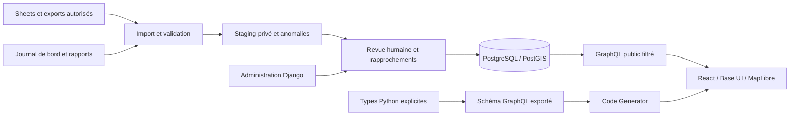

# Architecture de Mediterranée Rescue

Décision du 24 octobre 2026, à la demande de Guillaume. Le projet devient une plateforme maintenable. Le démonstrateur précédent est conservé comme historique, il ne constitue plus l’architecture du produit. Ces décisions sont celles du fork ; l’adoption par Data for Good/SOS reste à discuter.

## Stack retenue

| Couche | Décision | Raison |
| --- | --- | --- |
| Interface | React 19, TypeScript strict, Vite, pnpm | Application cartographique, build statique et outillage simple |
| Composants | Base UI 1.9, CSS et tokens propres au projet | Même fondation que Memo Orbit, sans coupler les deux projets |
| Carte | MapLibre GL JS 6 | WebGL, GeoJSON, clustering, évolution vers tuiles vectorielles |
| Client GraphQL | urql et TypedDocumentNode générés | Requêtes typées, états de chargement/erreur, annulation/cache documentaire |
| Backend | Python 3.12+, Django 5.2 LTS, Strawberry Django | Modèle relationnel, migrations, administration, permissions ; schéma GraphQL typé |
| Base | PostgreSQL 17 + PostGIS 3.6 | Transactions, contraintes, index géographiques et filtres spatiaux |
| Contrat | Schéma SDL exporté du backend, GraphQL Code Generator client preset | Types de chaque opération réellement appelée, contrôlés par la CI |
| Tests | Django TestCase sur PostGIS, tests frontend, TypeScript, build, contrôles de contrat | Ne pas remplacer PostGIS par SQLite dans les tests |
| Exécution | Docker Compose en local, backend WSGI, frontend statique | Même base technique en intégration et futur hébergement |

Django 5.2 est un choix de support long, avec support de sécurité annoncé jusqu’en avril 2028 : https://www.djangoproject.com/download/. Base UI 1.9 est la version utilisée dans le projet récent Memo Orbit, vérifiée dans son package.json. Les versions exactes sont verrouillées dans les lockfiles. Les choix d’hébergement et d’identité en production ne sont pas décidés par un déploiement implicite.

## Architecture logique

Un backend modulaire, une base relationnelle, pas de microservices. Modules : catalogue métier, provenance, ingestion, publication et API. Les services de domaine portent les règles et transactions ; l’administration et les futurs mutations GraphQL les appellent. Les modèles ORM ne sont pas exposés automatiquement en totalité.

## Modèle métier et relations

- Source : organisation, URL, licence, autorisation de publication, nature réelle/synthétique. Une source consultable n’est pas automatiquement redistribuable.
- Navire : UUID interne, nom, identifiants maritimes seulement lorsqu’ils sont vérifiés.
- Voyage/rotation : navire, période, URL du journal. Un voyage contient plusieurs événements ; une page “operation” du logbook peut désigner un voyage entier.
- Événement : sauvetage, transfert, évacuation médicale, incident ou naufrage, date et précision, position et précision, effectifs agrégés, voyage/navire/port facultatifs, statut de publication.
- Port : UUID, nom et point ; les alias source devront être validés, jamais joints silencieusement par similarité.
- Preuve : lien source, libellé et relation à un événement. Aucun témoignage nominatif, image ou vidéo n’est recopié par défaut.
- Lot d’import : source, empreinte de contenu, version du contrat, statut et rapport. Les lignes de staging conservent provenance et payload privé ; les erreurs ne provoquent pas une publication partielle.
- Révision de publication : acteur, horodatage, ancienne/nouvelle valeur et motif. Publication explicite après validation des droits et des données.
- À ajouter dans les tranches suivantes : entrées de journal, révisions d’effectifs estimés/confirmés, alias de ports, crosswalk des identifiants Sheets, couches SAR/eaux territoriales avec autorité et période d’effet.

## Invariants

UUID interne stable ; identifiant source distinct. Le numéro d’une ligne Sheets n’est pas un identifiant stable. La migration doit conserver un crosswalk approuvé. `null` signifie inconnu et ne devient jamais zéro. Date observée, date d’import et date de publication sont distinctes. Position inconnue reste absente ; position approximative porte sa précision. Les sous-populations peuvent se chevaucher. Les transferts ne sont pas additionnés aux sauvetages pour prétendre compter des personnes uniques.

Le filtre canonique est partagé par liste, carte et statistiques. L’API publique ne voit que les événements publiés et les sources explicitement autorisées. Les champs internes de staging et d’audit ne figurent pas dans le schéma public. Les données d’entraînement sont séparées par un mode explicite ; un environnement de production ne les charge pas silencieusement.

## Typage de bout en bout

Les modèles Django assurent la persistance et les contraintes ; les types Strawberry déclarent une sélection publique explicite. Le backend exporte contracts/schema.graphql. Le frontend écrit des opérations GraphQL ; Code Generator les valide contre le schéma et génère résultats/variables en TypeScript. `TypedDocumentNode` est consommé directement par urql, sans `as Event[]` ni DTO recopié à la main. TypeScript est strict. Les scalaires Date/DateTime/UUID ont un mapping explicite ; scalar inconnu = échec de génération, pas any.

En CI : migrations sans dérive, tests PostGIS, export du schéma, régénération du client, diff des fichiers générés, typecheck et build. Une requête sur un champ supprimé échoue avant fusion. Un changement de nullabilité change les types du résultat et impose le traitement côté UI. Les types ne prouvent ni la véracité ni la qualité des données importées : parseurs et règles métier exécutés côté serveur restent nécessaires.

## Sécurité GraphQL et exploitation

Pas de mutations anonymes ni d’exposition automatique des modèles. Pagination plafonnée, bornes de carte, profondeur et alias limités, taille de requête bornée. Éviter N+1 par chargement explicite des relations, vérifié par budget SQL. Sessions et CSRF Django pour l’administration. L’interface publique utilise des requêtes de lecture ; les futures mutations passeront par les mêmes permissions et services métier.

La production exige secret fourni, debug désactivé, hôtes autorisés, cookies sécurisés et HTTPS ; la configuration doit échouer sans secrets. Aucune clé Google/Mapbox n’est nécessaire au client. Pas de téléchargement serveur d’URL arbitraires dans la première tranche. Les sources sont déclarées par un opérateur ; les prochains connecteurs auront une liste de domaines, délais, limites et protection SSRF.

Sauvegardes PostgreSQL chiffrées hors machine, restauration testée, métriques d’import, erreurs et latence requises avant mise en service. Objectifs proposés à faire valider : RPO 24 h, RTO 4 h. Import planifié d’abord par commande idempotente ; ajouter file de tâches seulement lorsque durée/reprises le justifient. Redis, Celery, moteur de recherche et vector database ne sont pas nécessaires à cette fondation.

## Première tranche construite maintenant

Structure backend/frontend et locks, schéma PostGIS initial, contrats GraphQL publics de lecture, staging local idempotent, publication contrôlée, administration, carte reliée au backend, codegen et contrôles CI. Les fixtures ne servent qu’aux tests et à un mode d’entraînement explicitement chargé. Aucun téléchargement ni republication du dataset SOS sans clarification des droits.

## Roadmap produit, non confondue avec cette tranche

1. Cadrer droits, utilisateurs et critères métier avec SOS/DfG ; vérifier le rôle de CartONG.
2. Migrer les trois onglets via snapshots/crosswalk, rapprochements contrôlés et revue des anomalies.
3. Relier voyages et journal de bord ; distinguer estimations/corrections ; ajouter couches géographiques qualifiées.
4. Définir les vues éditoriales, l’accessibilité, les performances et la recette avec les personnes qui actualisent les données.
5. Préparer l’hébergement, l’identité, la restauration, l’observabilité et la passation bénévoles avant publication.

Sources techniques : https://strawberry.rocks/docs/django ; https://strawberry.rocks/docs/django/guide/optimizer ; https://the-guild.dev/graphql/codegen/plugins/presets/preset-client ; https://base-ui.com/react/overview/quick-start ; https://maplibre.org/maplibre-gl-js/docs ; https://docs.djangoproject.com/en/5.2/howto/deployment/checklist/.
