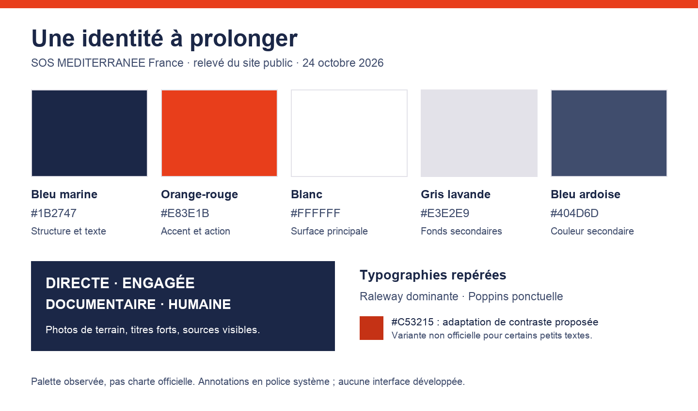

# Référence visuelle : SOS MEDITERRANEE

Relevé du site français le 24 octobre 2026, pour guider la future application React + **Base UI**. Cette fiche distingue les observations des propositions. C’est une base de travail issue du site public, pas une charte officielle validée par l’association. Aucune modification de l’application n’est incluse.

## 1. Identité observée

Le site associe bleu marine profond et orange-rouge à de grands titres gras, beaucoup de blanc et des photos de terrain. Les sujets sont humains : personnes secourues, équipages, bénévoles, gestes de secours et témoignages. Les chiffres sont accompagnés de contexte et de références datées. Le ton visuel est direct, engagé et documentaire.

Le logo apparaît notamment en blanc sur fond bleu marine. Les titres et blocs de contenu ont une hiérarchie forte ; les liens et appels à l’action orange attirent le regard. Certains boutons sont très arrondis, alors que plusieurs liens d’action restent simples, avec flèche. Il n’y a donc pas un rayon unique à reproduire pour tous les composants.

## 2. Palette réellement relevée

Les codes suivants sont présents dans les feuilles de style du thème SOS MEDITERRANEE. Les couleurs et polices de plusieurs éléments ont aussi été vérifiées dans le navigateur. Il existe des variantes voisines ; la liste ci-dessous est une sélection de référence, pas une extraction complète des couleurs du site.

| Couleur | Code | Usage observé | Rôle proposé dans l’application |
| --- | --- | --- | --- |
| Bleu marine | #1B2747 | Textes, navigation et aplats | Texte principal, en-tête, repères structurants |
| Orange-rouge | #E83E1B | Liens, boutons et accents | Accent de marque, sélection et action importante |
| Blanc | #FFFFFF | Fonds, texte sur fond sombre, logo | Surface principale et respiration |
| Gris légèrement lavande | #E3E2E9 | Fonds secondaires, séparateurs et états de liste | Panneaux secondaires et séparation légère |
| Bleu ardoise | #404D6D | Cartes d’articles et certains blocs secondaires | Texte secondaire ou surface ponctuelle, après vérification du contraste |

Les variantes #1A2747, #192649 et #F03E1B sont également présentes dans les CSS. Pour le projet, proposer une palette resserrée plutôt que reproduire toutes les variations historiques. Les noms de rôles du tableau sont nos propositions ; ils ne sont pas des tokens officiels fournis par SOS.

## 3. Typographie observée

**Raleway domine les éléments contrôlés** : titres principaux en graisse800, navigation en900, paragraphes de la page Missions en500, certains textes de l’accueil en600/700. **Poppins apparaît également**, notamment dans certains blocs/labels ; sa présence dans les CSS ne signifie pas qu’elle est la police principale de toutes les pages.

Proposition pour l’application : Raleway comme famille principale pour conserver le lien visuel, avec titres700/800, texte courant400/500 et contrôles600. Vérifier sa lisibilité sur les tableaux et les petits nombres avant de figer le choix. Tester des chiffres tabulaires lorsqu’ils sont disponibles ; ne pas réduire la taille du texte pour faire entrer les tableaux. Taille de corps proposée :16px minimum, adaptation au contexte et zoom conservé.

La planche de couleurs sert au relevé des teintes. Ses annotations utilisent une police système neutre ; elle ne constitue pas un spécimen exact des fontes SOS.

## 4. Transposition à notre application

| Élément | Direction proposée |
| --- | --- |
| Navigation | Bandeau marine, hiérarchie simple, nom du service lisible |
| Écrans de données | Fonds blancs, texte marine, tableaux lisibles, peu de décoration |
| Actions | Orange réservé à quelques actions importantes ; actions secondaires plus sobres |
| Filtres | Base UI, libellés explicites, sélection et focus visibles |
| Fiches d’événements | Date, nature, effectif connu/inconnu, contexte et source au premier plan |
| Chiffres | Valeur, définition, période et source ; ne pas transformer un total d’événements en nombre de personnes uniques |
| Carte future | Fond discret ; marqueurs et légende accessibles, cohérents avec la palette sans tout colorer en orange |
| Photographies | Images de terrain contextualisées et créditées, fichiers appropriés à l’usage retenu |
| Formes et effets | Rayons mesurés et cohérents, bordures simples, ombres rares |

L’application doit sembler appartenir au même univers que le site de l’association, avec une ergonomie adaptée à l’exploration de données. Les grands bandeaux photographiques du site de communication ne sont pas à recopier dans chaque écran de travail. Ne pas utiliser des portraits générés pour représenter les personnes secourues. Ne pas redessiner le logo en texte ou modifier ses proportions ; employer le fichier officiel approprié lorsque le cadre du projet est validé.

## 5. Contrastes à préserver

Ratios calculés à partir des couleurs hexadécimales :

| Association | Ratio approximatif | Conséquence |
| --- | ---: | --- |
| Marine #1B2747 / blanc | 14,71:1 | Très bonne base pour le texte |
| Marine #1B2747 / gris #E3E2E9 | 11,43:1 | Bonne base pour les panneaux secondaires |
| Orange #E83E1B / blanc | 4,09:1 | Ne satisfait pas4,5:1 pour du petit texte normal ; peut convenir au grand texte selon le critère |
| Orange sombre proposé #C53215 / blanc | 5,47:1 | Variante possible pour des petits liens ou boutons à texte blanc |

**#C53215 est une adaptation proposée, pas une couleur officielle observée.** On peut aussi conserver l’orange de marque comme accent graphique et utiliser le marine pour les textes. Les combinaisons réelles, états de focus, pictogrammes et fonds cartographiques devront être testés lors de l’implémentation. Une couleur ne doit pas être le seul moyen d’exprimer une erreur ou une sélection.

Référence : [WCAG2.2, contraste minimum](https://www.w3.org/WAI/WCAG22/Understanding/contrast-minimum.html), seuil4,5:1 pour le texte normal et3:1 pour le grand texte selon la définition du critère. Le relevé n’est pas un audit complet d’accessibilité du site SOS.

## 6. Design system et parcours préparés

Le relevé de marque ci-dessus alimente maintenant la [spécification du système](system.md), les [contrats de composants](components.md), les [parcours utilisateur](user-flows.md) et la [recherche UX](ux-references.md). Les tokens incluent désormais des propositions de couleurs d’état, espacements et dimensions ; leur origine est indiquée. Ces ajouts restent des spécifications et références, pas une interface construite.

## 7. Fichiers utilisables dans ce dépôt

- [Guide à la racine](../../DESIGN.md) : point d’entrée pour tout agent qui prépare une interface.
- [Couleurs et rôles JSON](tokens.json) : valeurs de marque observées, rôles proposés et provenance.
- [Variables CSS de référence](tokens.css) : palette, rôles sémantiques et famille typographique, sans dépendance.
- [Portée et vérifications de l’intégration](integration.md).

Les variables sont prêtes à reprendre lors de la tranche interface. Ce fichier CSS n’est pas importé dans le frontend existant : aucune modification d’écran n’est effectuée par cette intégration documentaire. Les polices ne sont pas embarquées ni chargées automatiquement ; leur chargement explicite reste à traiter au lot UI. Les noms de variables et rôles du projet ne constituent pas des tokens officiels de l’association.

## 8. Consigne pour l’agent de code

Conserver la décision **Base UI**. Ne pas installer DaisyUI. À la future tranche interface, décliner ces couleurs en rôles cohérents : surface, texte, bordure, marque, action, sélection et focus. Séparer couleurs de marque et couleurs d’état ; tester le contraste de chaque combinaison. Commencer par un écran de données représentatif avec une liste et une fiche, puis faire valider la direction visuelle avant d’étendre les composants. Aucune refonte UI n’est demandée tant que la priorité reste la donnée.

## Sources et méthode

- [Accueil de SOS MEDITERRANEE France](https://sosmediterranee.fr/), inspection visuelle et styles calculés des titres, textes, boutons et liens.
- [Missions et organisation](https://sosmediterranee.fr/mission-sauvetage-en-mer/), seconde page pour vérifier hiérarchie, navigation et texte courant.
- Feuilles de style custom.css et style.css du thème sosmediterranee, liées par la page d’accueil au moment du relevé. Les couleurs du tableau y sont présentes ; les déclarations de polices ont été croisées avec les éléments rendus.

Ce qui reste à obtenir auprès de l’association si le projet est adopté : charte officielle éventuelle, fichiers de logo et consignes d’usage des photos. Le relevé actuel suffit pour documenter une direction cohérente ; il ne prétend pas remplacer ces ressources.
