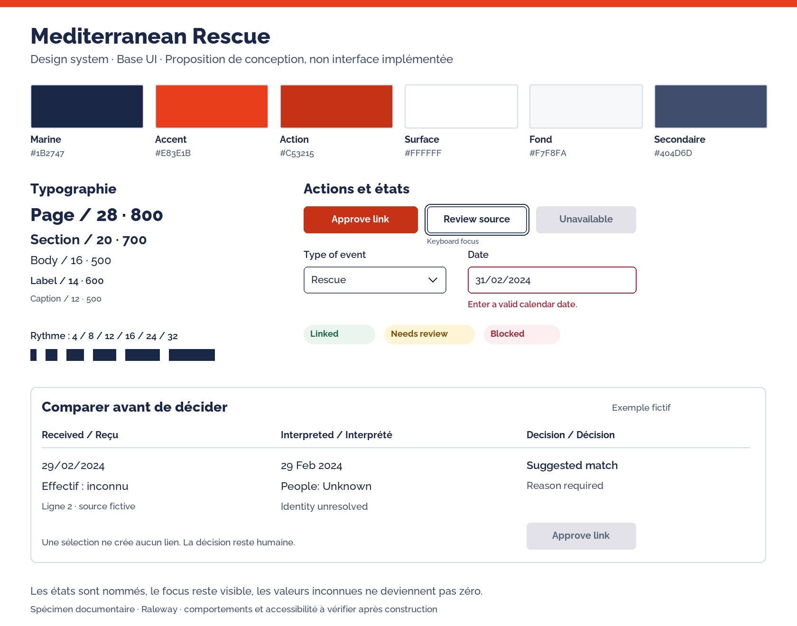

# Design system Base UI : spécification v1

24 octobre 2026. Statut : proposition à relire et à implémenter par l’agent de code. Les tokens JSON/CSS sont utilisables comme référence ; les composants décrits ici ne sont pas encore construits. La carte et le CSS actuels ne représentent pas cette direction finale.

## Intention

Aider une personne à comprendre ce qu’elle regarde, ce qui est connu et ce qu’elle peut faire ensuite. Conserver l’identité SOS MEDITERRANEE : marine, orange-rouge, blanc, typographie affirmée et contenus sourcés. Les interactions servent à examiner et décider. Les personnes secourues ne deviennent ni scores ni éléments de décoration.

[Référence de marque](sos-visual-reference.md) · [Recherche UX](ux-references.md) · [Parcours](user-flows.md) · [Contrats de composants](components.md).

## 1. Architecture de composants

| Couche | Contenu | Responsabilité |
| --- | --- | --- |
| Fondations | tokens, typographie, dimensions et états | Une valeur cohérente par rôle |
| Primitives | Base UI1.9.0 déjà installé | Comportements d’interaction et sémantique des contrôles |
| Composants projet à créer | Button, Field, Select, Dialog et autres wrappers minces | Habillage et conventions répétables, conservation des capacités Base UI |
| Patterns métier à créer | FileDiagnostic, ReviewQueue, RecordComparison, PublicationSummary | Donnée et intention, sans réimplémenter les primitives |
| Écrans futurs | Imports, revue, ports, publication, exploration publique | Assemblage des patterns selon les parcours |

Utiliser les exports publics documentés de @base-ui/react. Ne pas importer ses internals. Conserver les propriétés accessibles, refs et états des primitives dans les wrappers. Ne pas installer une deuxième bibliothèque de contrôles. Tableaux, badges, pagination, upload et états vides sont des compositions HTML/CSS du projet : Base UI ne fournit pas un DataGrid ou un pipeline d’import métier prêt à l’emploi.

Arborescence proposée à l’implémentation : frontend/src/design-system/ pour fondations et contrôles, frontend/src/features/ pour patterns métier, catalogues de traduction partagés. Ce découpage est une cible, pas des modules existants.

## 2. Couleurs par rôle

Les teintes de marque observées restent identifiées dans tokens.json. Les neutrals, teintes d’état et rôles ci-dessous sont des propositions de l’application.

| Rôle | Valeur ou référence | Utilisation |
| --- | --- | --- |
| Texte principal et structure | marine #1B2747 | Titres, texte, navigation |
| Texte secondaire | ardoise #404D6D | Contexte et descriptions |
| Texte discret | #596579 | Métadonnées lisibles, pas de réduction d’opacité globale |
| Surface principale | blanc | Zone de lecture et de travail |
| Fond de page | #F7F8FA | Délimiter la page sans multiplication de cartes |
| Surface secondaire | #E3E2E9 | Groupements et éléments désactivés selon contexte |
| Bordure décorative | #D5DAE3 | Séparateurs ; insuffisante seule pour identifier un champ interactif |
| Bordure de contrôle | #596579 | Contour visible des champs |
| Accent de marque | orange #E83E1B | Repères graphiques, indicateur de sélection |
| Action principale et lien | orange sombre proposé #C53215 | Texte blanc sur bouton et petits liens sur blanc |
| Survol de l’action | #AB2A11 | Renforcer le retour sans déplacement |
| Sélection | fond #FFF0EB, texte marine, repère orange | Ne pas confondre avec une erreur |
| Succès technique | #17634A sur #EAF5EF | Enregistrement confirmé |
| Avertissement | #7A4A00 sur #FFF4D6 | Élément à examiner, limite ou incertitude |
| Erreur | #9F2534 sur #FDEFF1 | Validation bloquante ou échec expliqué |
| Information | #234D7A sur #EEF4FA | Indication neutre et contexte |

Toujours associer état, libellé et éventuellement pictogramme ; la couleur ne suffit pas. Les catégories d’événements et leurs effectifs n’utilisent pas ces couleurs pour juger une situation humaine. Une palette cartographique distincte, testée et légendée, sera spécifiée au lot exploration.

Le thème clair est la cible de la première livraison UI. Le thème sombre reste un suivi explicitement séparé, avec tokens et tests à définir ; ne pas inverser automatiquement les couleurs du thème clair.

## 3. Typographie

Raleway comme famille principale proposée, fondée sur le site observé. Un fallback système garantit un affichage lisible avant chargement. Poppins reste une observation secondaire, sans second chargement par défaut. Chargement explicite des fontes à faire au lot UI ; pas de fonte supposée déjà embarquée.

| Rôle | Taille / interligne | Graisse | Usage |
| --- | --- | --- | --- |
| Caption | 12 /18px | 500 | Provenance secondaire, jamais une donnée cruciale seule |
| Label | 14 /20px | 600 | Libellé de contrôle et en-tête de colonne |
| Body | 16 /24px | 500 | Lecture courante, valeurs et messages |
| Section | 20 /28px | 700 | Groupe ou panneau |
| Page | 28 /36px | 800 | Un titre par écran |
| Display | 36 /44px | 800 | Usage éditorial ponctuel, pas dans la file de revue |

Chiffres alignés à droite dans les tableaux, option tabular-nums, unités visibles. Inconnu se traduit par un mot explicite et reste distinct de0. Dates formatées selon la langue ; une date seule ne reçoit pas d’heure ni de fuseau inventé. Les codes techniques et UUID ne deviennent pas le libellé principal d’une ligne.

## 4. Espacements et densité

Échelle4px : 0,4,8,12,16,20,24,32,40,48,64. Espacement interne courant16px ; sections24/32px ; groupes de formulaire24px. Rayons4px pour petits éléments,8px pour contrôles/panneaux,12px pour dialog ; pill réservé aux filtres et libellés compacts.

Contrôles par défaut44px de haut. Variante compacte36px seulement dans un contexte desktop maîtrisé ; cible tactile44px conservée par le conteneur. Ligne courante56px, compacte44px ; pas de hauteur fixe qui coupe des descriptions ou erreurs. Icônes dessinées sur une grille20/24px, cible44px. Afficher un libellé quand le sens n’est pas évident ; un tooltip complète mais ne remplace pas un nom accessible.

## 5. Mise en page

| Largeur de conception | Organisation proposée |
| --- | --- |
| ≥1440px | Navigation224px, contenu fluide, inspecteur400px lorsqu’ouvert |
| 1024–1439px | Navigation repliable, liste prioritaire, inspecteur si l’espace suffit |
| 640–1023px | Navigation en Drawer ; détail sur une route dédiée si le panneau comprime la liste |
| <640px | Une colonne, marges16px, filtres dans un Drawer avec récapitulatif visible |

Les seuils responsive sont définis dans tokens.json et doivent devenir des conditions media statiques ; une variable CSS ne peut pas être utilisée directement comme condition de media query.

Marges desktop32px ; contenu utile plafonné à1440px pour les vues de lecture, grille de travail adaptable. La disposition dépend aussi de l’espace réellement disponible, pas seulement de la taille physique de l’écran. À200% de zoom, privilégier le reflow. Les tableaux complexes peuvent défiler horizontalement dans une région nommée ; aucune autre zone ne doit imposer un défilement horizontal global.

Une navigation, une zone de travail, un inspecteur : pas de mosaïque de cartes pour chaque champ. Le contenu essentiel doit rester utilisable sans carte WebGL.

## 6. États communs

| État | Comportement attendu |
| --- | --- |
| Default | Action et valeur lisibles, aucun état validé sous-entendu |
| Hover | Changement de surface ou couleur mesuré, pas de mouvement de mise en page |
| Focus-visible | Anneau2px avec décalage2px, contrasté sur la surface réelle ; variante claire sur fond marine |
| Selected | Fond sélection + repère + état sémantique ; focus conservé séparément |
| Loading | Action déjà nommée, attente annoncée, double soumission empêchée |
| Disabled | Texte lisible, action indisponible et raison expliquée à proximité si nécessaire |
| Invalid | Résumé cliquable et message près du champ, saisie conservée |
| Empty | Distinguer absence de données, aucun résultat filtré et absence de permission |
| Error | Cause compréhensible, état connu/inconnu de l’opération, reprise sûre |
| Success | Confirmation durable dans l’écran, toast seulement complémentaire |

Pas de spinner seul sans texte, de faux pourcentage ou de disparition immédiate d’une ligne non enregistrée. Ne pas utiliser le toast comme seul endroit où comprendre une erreur ou l’effet d’une validation.

## 7. Mouvement et couches

Transitions120ms pour survol/focus,180ms pour ouverture ; maximum240ms. Préférer opacity/transform et éviter les animations en boucle. Avec prefers-reduced-motion, transitions de référence à0ms et pas de déplacement animé imposé. Le mouvement sert à comprendre un changement d’état.

Ombres réservées aux surfaces temporaires : popup et dialog. Couches proposées : contenu0, sticky10, popover20, backdrop30, dialog40, toast50. Placer les popups ouverts depuis une dialog dans le bon contexte de portail : augmenter arbitrairement un z-index n’est pas une solution. Tester Tab, Escape et restauration du focus.

## 8. Langue et ton

Produit en anglais par défaut, première traduction française, conformément à AGENTS.md. Tous les textes futurs passent par un catalogue : clés stables, pluriels et nombres localisés. Les libellés français de cette documentation décrivent le parcours ; ils ne doivent pas être recopiés en dur dans les composants.

Préférer un verbe et un objet : « Approve link / Valider le lien », « Publish event / Publier l’événement ». Un message explique ce qui s’est passé et quoi faire. Éviter les codes techniques seuls, les formulations culpabilisantes et les boutons « OK » ou « Continuer » lorsque l’effet peut être nommé.

## 9. Première livraison UI à construire

Un catalogue de composants interne, puis une file de revue représentative avec comparaison et tous ses états. Ne pas convertir immédiatement tous les écrans. Faire tester le parcours avant de décliner le système sur l’import, les ports et la publication. [Ordre détaillé et critères](user-flows.md).

La planche est une référence de conception statique ; elle ne prouve ni les comportements Base UI ni l’accessibilité d’une implémentation. Tests de composants, clavier, VoiceOver, contrastes, reflow, textes longs et préférence de mouvement restent nécessaires après construction.
