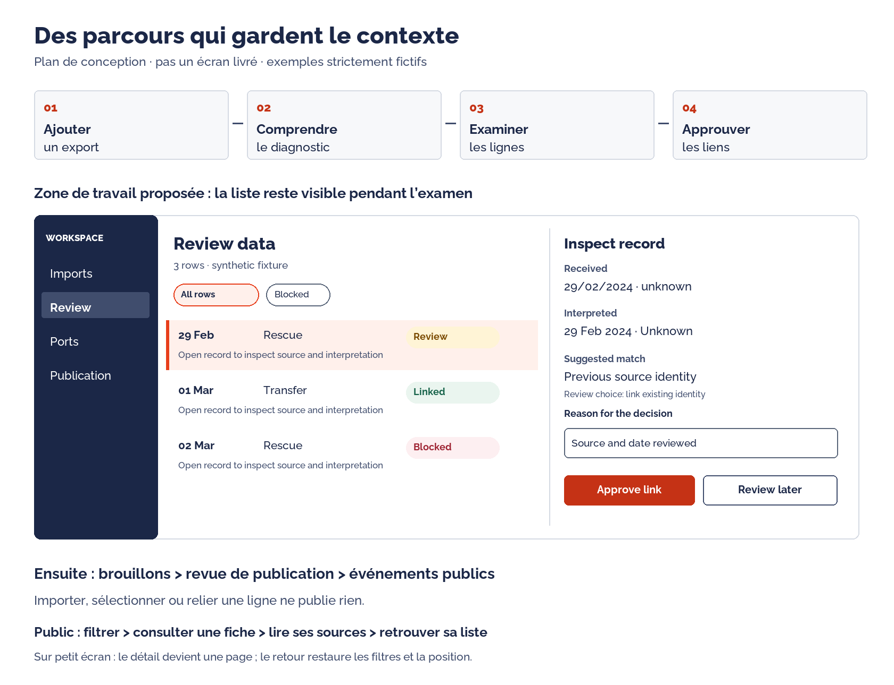

# Design flow et parcours utilisateur : plan concret

24 octobre 2026. Spécification pour l’agent de code. Les parcours ci-dessous sont proposés, pas des écrans déjà construits ou des besoins validés en entretien. Le socle dispose d’une API publique REST, de services métier et d’une administration Django ; les APIs privées et les écrans de revue décrits ici restent à construire.

## 1. Qui fait quoi

| Personne | Objectif concret | Ce que l’interface doit lui éviter |
| --- | --- | --- |
| Bénévole chargé des données | Ajouter un export et repérer ce qui demande une revue | Lire des JSON, comprendre une commande ou chercher dans28 colonnes |
| Relecteur d’identités/ports | Vérifier un rapprochement et expliquer sa décision | Mémoriser des UUID, perdre la source ou créer un doublon sans le savoir |
| Responsable de publication | Savoir exactement ce qui devient public | Confondre donnée importée, liée et publiée |
| Lecteur public | Comprendre une action, sa date et sa source | Lire des chiffres sans contexte ou dépendre d’une carte pour accéder à une fiche |

Les personnes secourues sont les bénéficiaires indirects du projet. Le produit n’affiche pas de dossiers personnels de rescapés ; il documente les actions et leurs sources, avec des effectifs agrégés et leurs limites.

## 2. Vue d’ensemble

Les étapes snapshot/identités/ports ont un socle métier dans ADR0005. La passerelle vers les brouillons et la revue de publication dans l’application sont des tranches ultérieures. Aucun clic de sélection ou diagnostic réussi ne franchit ces étapes implicitement.

## 3. Navigation et routes proposées

Les routes frontend sont des cibles de conception, distinctes des endpoints /api/v1 existants. Anglais par défaut, traduction des libellés via catalogues. Le changement de langue garde l’objet et le contexte consultés.

| Écran | Route frontend proposée | Action principale | État initial utile |
| --- | --- | --- | --- |
| W01 — Entrée de travail | /workspace | Ouvrir la prochaine tâche autorisée | Renvoi vers W04 si la revue est autorisée, sinon Imports si accessible, sinon accès insuffisant |
| W02 — Nouvel import | /workspace/imports/new | Analyser le fichier | Source, onglet, fichier et limites visibles |
| W03 — Diagnostic d’un import | Avant enregistrement : /workspace/imports/new/diagnostic ; après : /workspace/imports/:snapshotId | Examiner les lignes ou reprendre la source | Résumé de lecture, anomalies et portée |
| W04 — File de revue | /workspace/review | Examiner une ligne | Lignes à examiner par défaut, filtres et compteurs |
| W05 — Examiner une ligne | /workspace/review/:snapshotId/rows/:rowId | Valider une décision motivée | Source et interprétation côte à côte |
| W06 — Référentiel de ports | /workspace/ports | Examiner un libellé non résolu | Libellés, occurrences et proposition explicite |
| W07 — Examiner un libellé | /workspace/ports/:aliasId | Enregistrer son interprétation | Choix port(s), navire, ou pas un port |
| W08 — Préparation de publication | /workspace/publications | Ouvrir un brouillon éligible | Travaux en attente et obstacles visibles |
| W09 — Aperçu public | /workspace/publications/:eventId | Publier ou retirer avec motif | Contenu exact à rendre public et vérifications |
| P01 — Explorer | /explore | Filtrer puis consulter un événement | Liste utile, période/type, carte complémentaire |
| P02 — Fiche publique | /events/:eventId | Lire contexte et sources | Date, catégorie, effectif et provenance |
| P03 — Méthode | /methodology | Comprendre les données | Définitions, limites et règles de publication |

Navigation privée courte : Imports, Revue, Ports, Publication. N’afficher que les routes effectivement livrées dans le lot courant ; aucun lien vers un écran vide ou un bouton sans effet. Montrer les sections autorisées ; si une tâche est indisponible, expliquer le rôle requis. Une route saisie directement doit être contrôlée côté serveur. Les APIs privées ne reprennent pas la configuration de lecture anonyme des endpoints publics.

## 4. Parcours A — Comprendre un export et le préparer

### A1 — Ouvrir W02

Point d’entrée : « Add an export / Ajouter un export » depuis Imports ou depuis une file vide. Trois choix nommés : source, onglet et fichier CSV. Les valeurs viennent du serveur ; aucune clé de configuration à saisir. Une détection éventuelle de l’onglet est une proposition à confirmer.

La page montre taille/type acceptés et caractère privé du traitement. Bouton de sélection toujours disponible, dépôt glissé facultatif. Après sélection, afficher le fichier, sa taille et « Change file / Changer de fichier ». CTA : « Analyze file / Analyser le fichier ».

### A2 — Attendre avec un état honnête

Empêcher un deuxième envoi identique. Montrer l’étape connue et une attente indéterminée si aucune progression réelle n’est disponible. Un bouton pour quitter l’écran ne promet pas l’annulation d’un traitement serveur. Une réponse ambiguë après coupure impose une consultation de l’état existant avant nouvel envoi.

### A3 — Lire W03

Avant enregistrement, le diagnostic est une vue temporaire distincte d’un snapshot persistant : /workspace/imports/new/diagnostic. Un rechargement peut demander de sélectionner à nouveau le fichier. Après enregistrement réussi, la route devient /workspace/imports/:snapshotId et les données persistantes sont relues au serveur. Aucun identifiant de snapshot n’est inventé pendant une simple analyse. Toute rétention temporaire côté serveur devra avoir un contrat de durée et de nettoyage. L’enregistrement revérifie le fichier et la version de contrat côté serveur ; il ne fait pas confiance au diagnostic renvoyé par le navigateur.

Ordre d’information : état de lecture → lignes reçues/ignorées/en erreur → catégories d’anomalies → liens vers les lignes → prochaine action. Les trois onglets ont des libellés humains avec leur nom source en aide. Une carte n’apporte rien à cette étape.

- Lecture rejected/partial ou erreur de structure globale : « Review source file / Revoir le fichier source ». Donner le motif et la localisation disponible ; pas de bouton qui force l’import.
- Lecture end_unverified : expliquer que la dernière ligne n’a pas de fin de ligne ; distinguer cette réserve du format invalide, selon le contrat réel du diagnostic.
- Snapshot exploitable avec lignes bloquées : elles restent visibles et non éligibles ; l’outil ne les compte pas comme lignes approuvées. La décision de persister un snapshot suit le service métier existant.
- Lecture exploitable : « Save private snapshot / Enregistrer le snapshot privé », puis confirmation avec sa référence et accès à W04.

Si le même snapshot/contrat a déjà été enregistré, ouvrir l’existant avec un message clair plutôt que créer un doublon. Les données brutes demeurent immuables ; corriger un fichier signifie charger une nouvelle version, pas modifier l’ancien snapshot.

### A4 — Critère de réussite

Le bénévole sait ce qui est reçu, ce qui bloque et quelle action permettra d’avancer. Il sait qu’aucun événement n’est publié par cette opération. Aucune information privée n’est placée dans l’URL ou un stockage navigateur persistant.

## 5. Parcours B — Examiner une ligne sans perdre le contexte

### B1 — Arriver sur W04

Liste paginée25 lignes : date, catégorie, effectif connu/inconnu, source/onglet, motif de revue, état. Facettes avec compteurs : À examiner, Bloquées, Déjà liées. Ces catégories sont exclusives dans leur définition affichée ; ne pas additionner des compteurs qui se recouvrent sans l’expliquer.

Par défaut, ouvrir les tâches que la personne peut effectuer. Le statut blocked donne accès au diagnostic et à la reprise source, pas à une validation interdite. Un lien de titre ouvre W05. Filtres et défilement restent en place ; l’URL peut contenir seulement des identifiants opaques autorisés et des critères sans valeurs brutes.

### B2 — Voir W05

Sur écran large, panneau d’examen à droite de la liste. Trois parties :

1. « Received / Reçu » : valeurs exactes et provenance, sans transformation cachée.
2. « Interpreted / Interprété » : date, catégorie, effectifs et position candidates ; différence entre inconnu, zéro et erreur.
3. « Suggested match / Correspondance proposée » : identité, raisons de proposition et différences utiles, ou absence de candidat.

Déplier le contenu complet à la demande. Un candidat n’est pas choisi automatiquement. Les ressemblances ne deviennent pas une identité approuvée. L’effet d’une décision doit être compris avant l’envoi.

### B3 — Choisir puis enregistrer

Décisions proposées, soumises aux droits et services : créer une identité, relier à une identité existante, examiner plus tard. Le motif est obligatoire pour une approbation. Le contrôle catalog.review_identity est réappliqué côté serveur.

CTA adapté au choix : « Create identity / Créer l’identité » pour une nouvelle identité, « Approve link / Valider le lien » pour un rattachement ; la variante avec ouverture de la suivante garde ce verbe explicite. Si l’utilisateur choisit une identité existante à la main, l’état enregistré est reviewed_match selon ADR0005, pas exact_carry. La confirmation durable montre « Linked · Private / Liée · Privé » et la décision enregistrée.

La deuxième action avance seulement après succès serveur. Si la ligne disparaît du filtre À examiner, garder une confirmation et choisir la suivante logiquement ; ne pas provoquer de saut imprévisible. S’il n’y a plus de tâche, montrer une fin de file honnête et « Voir les lignes liées ».

### B4 — Interruption ou conflit

Navigation avec motif modifié non soumis : avertir de la perte de saisie. Session expirée : conserver le minimum en mémoire, proposer de se reconnecter puis relire l’état serveur ; ne pas stocker les cellules privées localement. Réponse d’écriture perdue : vérifier si la décision existe avant répétition. Autre relecteur intervenu : afficher le nouvel état et refaire décider, sans écrasement.

Les décisions déjà enregistrées restent retrouvables. Une correction d’identité auditée nécessite un vrai service de correction ; ne pas afficher un bouton Annuler sans comportement serveur correspondant.

### B5 — Validation groupée optionnelle

Réserver aux reports exacts éligibles, sans ambiguïté, sur les lignes sélectionnées explicitement. Montrer le nombre et les identités concernées, le motif commun et la portée privée de l’action. Revérifier l’éligibilité au serveur au moment de confirmer. Aucun traitement groupé d’approbation des candidats approximatifs. La sélection « page courante » est claire ; les filtres la remettent à zéro.

## 6. Parcours C — Interpréter un libellé de port

W06 affiche le libellé reçu, ses occurrences et son état. W07 présente quatre interprétations exclusives : un port, plusieurs ports, un navire, pas un port. Ce dernier choix couvre notamment une région ou un libellé inconnu, avec explication.

Pour un port, utiliser une Combobox recherchable et présenter ses informations vérifiées. Un nom identique à la casse près peut être suggéré ; il n’est pas lié automatiquement. Une paire de ports n’est pas forcée vers un seul. Un nom de navire n’est pas géocodé comme une ville.

Si une position de port est ambiguë, demander explicitement longitude/latitude et motif de la position saisie, avec les valeurs source visibles. L’origine source/relecteur est conservée. Ne pas reprendre0,0 automatiquement. L’aperçu géographique peut aider à vérifier, mais le formulaire et ses explications restent complets sans carte.

Après « Save interpretation / Enregistrer l’interprétation », afficher la lecture approuvée et un retour vers les libellés non résolus. Le snapshot original n’est pas modifié.

## 7. Parcours D — Préparer puis publier, tranche ultérieure

Dépendances : passerelle identités→brouillons et API privée de publication à construire. W08 distingue brouillon éligible, droits manquants, source non approuvée et données à corriger. W09 montre exactement la version publique de l’événement, pas le payload de staging.

Avant publication : contenu et limites, source/licence/droits, auteur de la revue et motif. Le bouton nomme l’action « Publish event / Publier l’événement ». Les conditions sont réévaluées par le service transactionnel de publication, avec la permission catalog.publish_event. Aucun simple switch de tableau ne publie instantanément un événement.

Après succès, montrer le statut publié et la fiche publique. Pour corriger un contenu gelé : retirer avec motif, corriger le brouillon puis faire revoir avant republication. L’historique reste traçable. Si la source perd ses droits, la prochaine lecture publique applique la révocation ; expliquer l’indisponibilité sans montrer les données privées.

## 8. Parcours E — Comprendre un événement public

P01 s’ouvre sur une liste lisible et une carte complémentaire. Filtres initiaux limités à ce que l’API supporte : période, catégorie et zone géographique. Pas de barre de recherche générale, filtre navire/voyage ou graphique de totaux présenté comme opérationnel sans contrat backend correspondant.

Après chaque filtre valide : compteur et état d’actualisation. L’ordre public existant est chronologique ; la liste et la carte partagent les critères. Les points sont plafonnés à2000 : si tronqués, le dire et proposer de réduire le périmètre. Sans filtre géographique, un événement sans position reste consultable dans la liste. Avec une bbox active, les événements sans position sont exclus comme côté backend ; l’interface l’explique et permet de retirer ce filtre pour les retrouver.

La carte ne modifie la zone qu’après « Search this area / Rechercher dans cette zone ». La sélection d’un résultat et d’un point est liée ; ne pas déplacer brutalement la carte à chaque focus clavier. La liste reste entièrement utilisable si WebGL ou le fond échoue.

P02 est une vraie route partageable, avec panneau possible sur grand écran. Ordre de lecture : date/type → ce qui s’est passé → effectifs et limites → position connue/précision → source et licence. Retour à P01 restaure filtres/page/position. Les effectifs concernent des événements et ne sont pas présentés comme personnes uniques. P03 explique cette méthode.

404 après retrait : événement indisponible, retour vers l’exploration, aucun indice révélant son existence dans le staging. Aucune donnée en cache persistant qui contourne les règles serveur.

## 9. Matrice des états à dessiner et tester

| Situation | Ce que la personne voit | Action disponible |
| --- | --- | --- |
| Première utilisation privée | Une tâche possible et son contexte | Ajouter un export, selon ses droits |
| Aucun élément à revoir | Fin de file, nombre de décisions effectuées si calcul fiable | Voir les lignes liées ou Imports |
| Aucun résultat filtré | Critères actifs et absence de correspondance | Effacer un filtre ou tous |
| Lecture/chargement lent | Étape connue, attente indéterminée, contexte conservé | Attendre ou quitter sans faux annulé |
| Erreur de saisie | Résumé et message relié au champ | Corriger sans perdre le reste |
| Erreur de source | Ligne/champ/code expliqués, original conservé | Revoir la source et charger une version |
| Écriture au résultat incertain | Indication qu’une vérification est nécessaire | Relire l’état avant reprise |
| Conflit avec un autre relecteur | Ancien et nouvel état de décision | Réexaminer, sans écraser |
| Droits insuffisants | Permission nécessaire et contexte conservé | Retour ou contacter le responsable par son moyen habituel |
| Session expirée | Réauthentification requise, saisie non garantie après reload | Se reconnecter, relire et reprendre |
| Carte indisponible | Liste et détails accessibles | Continuer sans carte |
| Exemple d’entraînement | Bandeau permanent et libellés explicites | Explorer uniquement les fixtures |

## 10. Capacités serveur et ordre d’implémentation

| Lot | Contenu | Dépendance / sortie vérifiable |
| --- | --- | --- |
| UI0 — Fondations | Catalogues EN/FR, tokens, chargement fonte, composants P1 et page interne de catalogue | États, focus, contraste, reflow et clavier vérifiés |
| UI1 — Revue privée | API de lecture des snapshots/files et décisions autorisées, W04/W05, comparaison et motif | Services ADR0005 réutilisés ; refus, conflit, succès et reprise testés |
| UI2 — Import et ports | API privée bornée de diagnostic/staging, W02/W03/W06/W07 | Snapshot intact, réimport idempotent, aucune publication, reprise et alias vérifiés |
| UI3 — Préparer/publication | Passerelle vers brouillons, API privée revue/publication, W08/W09 | Règles du service de publication, droits, audit et retrait vérifiés |
| UI4 — Exploration publique | Refaire P01/P02/P03 sur le système validé | Filtres communs, sources, clavier/mobile, WebGL absent et méthode compris |
| UI5 — Finition mesurée | Actions groupées exactes, raccourcis utiles et améliorations issues des tests | Besoin confirmé, pas d’automatisation de décision ambiguë |

La page de catalogue UI0 est un outil de développement, non un écran du produit. Aucun besoin de nouvelle API publique pour afficher des composants isolés.

Le travail privé exige des endpoints aujourd’hui absents : consultation paginée des snapshots/lignes, propositions de rapprochement, approbations motivées et opérations de ports. Les services existants ne sont pas des endpoints frontend. Le prochain agent doit spécifier ces contrats, sessions/CSRF/permissions et erreurs avant de brancher les écrans. Les filtres/tri/pagination et versions de décision nécessaires doivent être définis au serveur ; aucun filtrage d’une page ne prétend filtrer une collection complète.

Ne pas télécharger l’intégralité des cellules privées pour fabriquer un tableau côté navigateur. Ne pas confondre le futur diagnostic HTTP avec la commande hors ligne existante. Si une opération passe en job asynchrone, son identifiant/statut/reprise/cancellation sont un contrat distinct à concevoir ; ne pas inventer une file de tâches dans les maquettes.

## 11. Recette d’intuitivité

Utiliser le [protocole de tests avec bénévoles](ux-references.md). Pour le premier cycle, prendre une fixture de20 lignes indépendantes contenant une date invalide, un effectif inconnu, un doublon et une proposition exacte. Faire expliquer la conséquence des décisions avant tout clic d’approbation. Les chiffres de cette recette sont synthétiques et ne décrivent pas le dataset SOS.

Chaque lot UI est prêt à relire quand ses parcours et cas d’échec ont des preuves réelles. Les planches jointes ne valident pas une interface : une revue sur écran réel et des essais au clavier restent nécessaires après implémentation.
