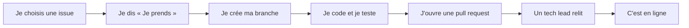

# Le guide des bénévoles

Bienvenue ! Cinq minutes pour savoir comment l'équipe marche et par où entrer.

## Le projet en deux phrases

SOS MEDITERRANEE secourt des personnes en détresse en Méditerranée centrale. Avec Data for Good,
on refait la carte publique de ses opérations, pour la transparence, le plaidoyer et la collecte
de fonds.

## Qui fait quoi

| Qui | Ce qu'il fait |
|---|---|
| SOS MEDITERRANEE | dit ce dont elle a besoin, valide ce qui est publié |
| Les PM/PO | recueillent les besoins, les transforment en issues |
| Les tech leads | préparent les issues, relisent et mergent, aident quand on bloque |
| Vous | prenez une issue, la menez jusqu'au merge, demandez de l'aide tôt |

On se retrouve sur le canal du projet du Mattermost de Data for Good : les rendez-vous y sont
annoncés.

## Le chemin d'une contribution

Le détail tient en cinq étapes : [CONTRIBUTING.md](../../CONTRIBUTING.md).

## Trois quêtes

On commence au niveau 1 quelle que soit son expérience : c'est le plus court chemin pour
connaître le projet. On passe au suivant quand la quête est faite.

**1. Premiers pas** ([guide](01-premiers-pas.md))
- [ ] Lancer l'API et la carte sur sa machine.
- [ ] Publier une opération fictive dans l'admin et la voir sur la carte.
- [ ] Faire merger une première pull request sur une `good first issue`.
- [ ] Noter dans une issue `docs` ce qui vous a surpris ou bloqué en arrivant.

**2. De bout en bout** ([guide](02-un-champ-de-bout-en-bout.md))
- [ ] Faire merger deux pull requests `niveau-2`, chacune avec ses tests.
- [ ] Relire la pull request d'un autre bénévole et y laisser un commentaire utile.

**3. Confirmé** ([architecture](03-architecture.md))
- [ ] Faire merger une pull request `niveau-3`.
- [ ] Aider un tech lead à découper une issue, ou proposer une [décision](../decisions/).

Quête 3 faite : vous pouvez relire des pull requests avec les tech leads.

## Sous la main

- Les mots du métier (SAR, MRCC, AIS…) : le [glossaire](../glossaire.md).
- Contribuer avec un assistant IA : [conseils](assistant-ia.md), facultatifs.
